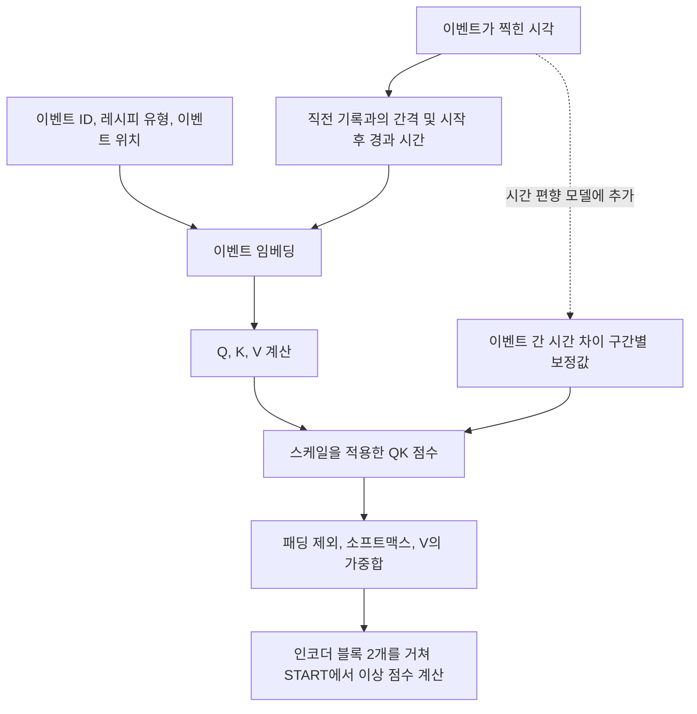

[English](README.md) · **한국어**

# Equip Triage

Equip Triage는 **한·영 장비 메모를 읽는 BERT 계열 트랜스포머**입니다. PyTorch로 인코더와 어텐션을 직접 구현했습니다. 등록된 점검 두 건과 메모 두 줄을 입력하면 후보별로 이상 지속·해소·결과 불명을 판정합니다. 한 건만 지속되고 다른 한 건은 해소됐을 때 점검 대상을 선택합니다. 출력에서 각 판정의 점수와 근거가 된 메모 줄 번호를 확인할 수 있습니다.

[메모 모델 실행](#메모-모델-실행) · [트랜스포머 구조](#트랜스포머-구조) · [Python API](docs/MEMO_MODEL.md) · [CSV 로그 검토](#csv-로그-검토) · [검증 자료](#검증-자료)

## 메모 모델 실행

Python 3.11 이상과 PyTorch가 있으면 [데모 가중치](models/memo-demo.pt)로 바로 실행할 수 있습니다.

```sh
python -m equip_triage predict --model models/memo-demo.pt --input examples/memo-input.jsonl
```

이 가중치는 **합성 기록 72건으로 학습한 실행 확인용**입니다. 벤치마크에서 평가한 가중치나 현장 배포용 모델은 아닙니다. [SHA-256](models/SHA256SUMS)

Python 3.11 이상과 PyTorch를 설치한 환경에서 저장소를 내려받아 다음 두 명령을 실행합니다.

```sh
python -m equip_triage train --data examples/memo-train.jsonl --out artifacts/memo.pt
python -m equip_triage predict --model artifacts/memo.pt --input examples/memo-input.jsonl
```

첫 명령은 직접 만든 합성 기록 72건으로 무작위 초기값에서 모델을 학습합니다. 둘째 명령은 저장한 가중치를 불러와 오프라인으로 추론합니다. 시드 42에서 예제 다섯 건의 판정은 차례로 `data`, `data`, `hold`, `hold`, `hold`입니다. 학습에 쓴 표현을 다시 사용해 한·영 단일 원인, 두 건 모두 지속, 결과 불명, 메모 한 줄 누락을 보여 줍니다. 예제의 점수 임계값은 0.50입니다. [학습 기록](examples/memo-train.jsonl) · [입력 예제](examples/memo-input.jsonl)

## 트랜스포머 구조


두 메모 줄은 따로 인코딩하며 같은 가중치를 씁니다. Q/K/V 투영, 패딩을 제외하는 양방향 어텐션, 두 잔차 연결, 층 정규화, GELU 피드포워드 층을 PyTorch로 직접 구현했습니다. 점검 후보마다 쿼리 하나를 만들어 등록 정보로 연결된 줄의 메모 토큰만 읽게 하고, 같은 분류기로 각 후보의 세 상태를 예측합니다. 마지막 점검 선택은 지속 건수와 점수 임계값으로 결정합니다. [편집 가능한 draw.io 원본 · 한글/영문 두 페이지](docs/assets/memo-transformer.drawio) · [모델 코드](equip_triage/model.py) · [도식 구성에 참고한 BERT 논문 그림 1](https://aclanthology.org/N19-1423.pdf#page=3)

```python
import json
from pathlib import Path
from equip_triage import load_checkpoint, predict

model = load_checkpoint("artifacts/memo.pt")
packet = json.loads(Path("examples/memo-input.jsonl").read_text(encoding="utf-8").splitlines()[1])
logits, attention = model(model.encode([packet]), return_attention=True)
print(predict(model, packet)["action"])  # data
```

[API, 텐서 차원, 체크포인트 형식, 직접 만든 데이터로 학습하는 방법](docs/MEMO_MODEL.md)

## CSV 로그 검토

저장소 루트에서 Python 3.11 이상으로 실행할 수 있습니다. 로그 검토 화면은 별도 패키지 설치 없이 실행됩니다.

```sh
python app.py --serve
python app.py --json
```

[한국어 화면](http://127.0.0.1:8765/?lang=ko)이나 [영문 화면](http://127.0.0.1:8765/)에서 **SIM-A / LOT-001**을 선택해 보세요. 순번 6은 누락됐고, 순번 7에는 서로 다른 기록이 들어와 있습니다. 화면에서 판정 보류 사유와 원본 행을 같이 확인할 수 있습니다.

- **입력:** [기본 합성 예제](examples/events.csv) 또는 UTF-8 CSV. 다른 파일을 보려면 `python app.py --input path/to/events.csv --serve`로 실행합니다.
- **CSV 형식:** `equipment,lot,sequence,time,code,memo`. 장비·LOT별 순번은 1부터 시작하며, 시각은 UTC 오프셋 또는 `Z`를 포함해야 합니다.
- **동작 범위:** Python과 SQLite를 이용한 오프라인 로그 검토. 화면의 점검 표시는 CSV 기록과 규칙을 기준으로 합니다. 실시간 수집·장비 제어·모델 추론은 기능 범위 밖입니다.

## 검증 자료

아래에는 기존 모델과 토크나이저, 평가 조건으로 얻은 결과를 보존했습니다. 이전 한·영 메모 시험에서 후보별 쿼리 BERT가 맞힌 짝은 세 시드 모두 영어·한국어 각 0/112쌍이었습니다. 위 패키지의 예제는 익숙한 표현으로 학습·저장·복원 경로를 확인합니다. [동결된 메모 평가 보고서](research/candidate-states/REPORT.md)

### 이벤트 모델


| 구성 | 역할 |
| --- | --- |
| [이벤트 인코더](research/public-logbert/bert_mlm.py) | 이벤트 ID와 시퀀스 안에서의 위치를 함께 입력. 은닉 차원 32, 어텐션 헤드 4개, 인코더 블록 2개로 구성. Q/K/V 계산, 패딩 마스크, GELU를 적용한 피드포워드 층, 잔차 연결과 LayerNorm을 PyTorch 기본 연산으로 구현. |
| [가린 이벤트 복원](research/public-logbert/bert_mlm.py) | 완료된 로그의 앞뒤 문맥으로 가려진 이벤트를 예측. 이벤트를 하나씩 가리고 예측했을 때의 평균 손실을 이상 점수로 사용. |
| [순서 분류](research/order-aware/study.py) | 앞뒤 이벤트의 정보를 반영한 `START` 벡터에 파라미터 33개짜리 선형 분류기를 연결. 정상 로그의 이벤트 복원과 정상·순서 오류 구분을 함께 학습. 이상 점수는 시퀀스당 인코더를 한 번 거쳐 계산. |
| [외부 비교 모델](research/external-comparison/README.md) | 사전학습 BERT-Tiny/Mini와 SmolLM2-135M-Instruct를 비교 대상으로 사용. SmolLM2는 가중치를 고정하고 예시 4개를 제공. |

위 이벤트 순서 실험의 인코더는 랜덤 초기값에서 학습합니다. 입력은 자연어 문장 대신 장비 이벤트 ID입니다. 양방향 인코더는 이미 끝난 로그를 다시 보는 용도이며, 별도 인과형 모델은 앞선 기록으로 다음 이벤트를 예측하는 비교 모델입니다.

### 한영 메모 판정

두 점검 중 하나만 계속 불량이고 다른 하나는 재검에서 정상이면 점검할 대상을 하나로 좁힐 수 있습니다. 둘 다 불량이면 판정을 보류합니다. 이 오프라인 실험은 등록된 점검 두 건과 한국어 또는 영어 메모 두 줄을 받아, 후보마다 **이상 지속·해소·결과 불명**을 구분합니다.

[이전 실험의 예시 도식](docs/assets/candidate-states-ko.svg)

그림은 직접 구현한 BERT 계열 모델의 동작을 **합성 예시의 정답 상태**로 설명합니다. 인코더는 두 줄을 따로 읽습니다. 각 후보의 쿼리는 등록 정보로 연결된 줄의 토큰만 읽고, 공유 분류기가 상태를 판정합니다. 같은 토큰을 균등하게 읽는 모델과도 비교했습니다. 대상에 따라 근거를 읽는 어텐션과 레이블 쿼리에는 선행 연구가 있습니다. [Wang 외, 2016](https://aclanthology.org/D16-1058/) · [Liu 외, 2021](https://arxiv.org/abs/2107.10834)

| 방식 | 지속 이상 1건·2건 구분, 영어 | 지속 이상 1건·2건 구분, 한국어 | macro-F1, 영어 / 한국어 |
| --- | ---: | ---: | ---: |
| 메모 절 단위 한영 규칙 | 70/112쌍 | 98/112쌍 | 0.803 / 0.942 |
| 후보와 연결된 줄을 읽는 문자 TF-IDF | 35/112쌍 | 83/112쌍 | 0.510 / 0.858 |
| 후보별 마스크를 적용한 자체 BERT | 0/112쌍 | 0/112쌍 | 0.170 / 0.170 |

한 건만 지속되는 메모를 올바른 점검에 연결하고, 두 건이 지속되는 짝 메모를 보류해야 한 쌍을 맞힌 것으로 셉니다. 학습·검증에 없던 합성 표현 가족 8개로 평가했습니다. 검증에서 선택한 기본값은 문자 모델입니다. 보류 정답 624건 중 영어 16건, 한국어 0건을 점검으로 잘못 넘겼습니다. 새 시험에서 가장 정확한 방식은 규칙이었고, BERT는 세 시드 모두 검증 임계값에서 전부 보류했습니다. 문자 모델에서는 후보별 상태를 읽고 지속 건수를 세는 방식의 이득이 확인됐습니다. 학습형 어텐션의 이득은 확인되지 않았습니다. [한영 CLI 실행](research/candidate-states/README.md) · [대조 실험·불확실성·점검 커버리지](research/candidate-states/REPORT.md)

### 벤치마크


| 평가 데이터 | 주요 결과 |
| --- | --- |
| [합성 순서 오류 400쌍](research/order-aware/README.md) | 이벤트 횟수만 비교하면 0/400건, 가린 이벤트를 복원하는 모델은 시드 3개에서 88~234/400건 탐지. 순서 분류를 추가하면 399~400/400건 탐지, 정상 400건 중 오경보 4~6건. 단계 순서가 고정된 이 조건에서는 선후관계 규칙이 400/400건, 오경보 0건으로 가장 정확. |
| [정상 절차 두 가지, 합성 192쌍](research/external-comparison/README.md) | 원본 로그 기준 자체 순서 분류 3/192건, BERT-Mini 81/192건, SmolLM2 3/192건 탐지(시드 42 비교). 학습용 정상 로그에서 공통 주요 단계를 골라 남기면 자체 모델과 BERT-Mini 모두 192/192건, 오경보 0건. 선후관계 규칙은 같은 결과를 더 빠르게 산출. 정상 절차 두 가지는 모두 학습에 포함했고, 오류 유형 하나만 테스트까지 분리. |
| [공개 Hadoop HDFS 블록 3만 건](research/public-logbert/RESEARCH.md) | 첫 분할에서 이벤트 횟수 기준 AP 0.9247, 이벤트 복원 모델 AP 0.6517. 두 번째 분할에서도 횟수 기준이 우세. 제조 설비 대신 실제 IT 시스템 로그로 진행한 비교. |
| [합성 장비 세션 3만 건](research/v03/RESEARCH.md) | 상태기계와 수치 규칙은 주입 오류 150/150건 탐지, 정상 2,850건 중 오경보 0건. 같은 수치 규칙을 붙인 인과형 트랜스포머는 Linux CPU 기준 150/150건 탐지, 오경보 98건. |

[벡터 그래프](docs/assets/external-benchmark.svg) · [지표 CSV](research/external-comparison/metrics.csv) · [합성 3만 건 노트북](notebooks/equip-triage-v03-30k.ipynb) · [데이터 출처](docs/EVALUATION.md)

**결과 해석:** 합성 실험에서는 주요 단계만 골라 비교했을 때 모델의 탐지율이 올라갔습니다. 같은 실험에서 선후관계 규칙은 정확도가 같고 처리 속도가 더 빨랐습니다. 실제 설비의 탐지율과 수율 개선 효과는 별도 검증이 필요합니다.

### 시간 간격 어텐션

읽기 전 10틱을 기다리는 상황을 가정했습니다. 긴 대기가 원래 필요한 단계라면 정상으로, 빠르게 끝나야 하는 단계라면 이상으로 봅니다. 이 차이를 잡기 위해 **시간 정보를 이벤트 입력에 넣는 방식**과 **입력에 더해 어텐션 점수에도 반영하는 방식**을 비교했습니다.

입력 쪽에는 직전 이벤트와의 간격, 로그 시작 후 경과 시간을 넣습니다. 어텐션 쪽은 두 이벤트 사이의 시간 차이를 방향과 크기에 따라 구간으로 나누고, 구간별로 학습한 값을 각 헤드의 QK 점수에 더합니다. 이 값이 더해지는 위치는 소프트맥스 직전입니다.



- **시간 오류:** 정상 로그에서 두 단계의 읽기 대기 시간만 맞바꿉니다. 이벤트 종류·횟수·순서, 전체 시간과 간격 값의 구성은 같습니다.
- **순서 오류:** 필수 `ACK`와 바로 뒤 `CLOSE`를 맞바꿉니다. 이벤트 종류·횟수와 모든 기록 시각은 그대로 둡니다.
- **검증 기준:** 같은 네 단계로 만든 절차 조합 24개를 학습 16개, 검증 4개, 테스트 4개로 나눕니다. 테스트 절차는 학습과 임계값 설정에서 제외합니다. 검증용 정상 256건의 점수에서 99백분위에 해당하는 값을 구하고, 이를 넘는 로그를 경보로 표시합니다.

| 방식 | 시간 오류 탐지 / 128건 | 순서 오류 탐지 / 128건 | 정상 오경보 / 256건 |
| --- | ---: | ---: | ---: |
| 레시피·단계별 학습 규칙 | 128 | 128 | 0 |
| 시간 미사용 인코더 | 0 / 0 / 0 | 123 / 128 / 128 | 0 / 0 / 0 |
| 입력에만 시간 반영 | 1 / 5 / 4 | 128 / 128 / 123 | 1 / 11 / 10 |
| QK 점수에만 시간 반영 | 0 / 1 / 3 | 128 / 128 / 128 | 0 / 3 / 6 |
| 입력과 QK 점수 모두에 시간 반영 | 0 / 3 / 1 | 127 / 128 / 121 | 0 / 5 / 2 |

표의 숫자 세 개는 같은 데이터로 학습 초기값을 바꿔 실행한 결과입니다(시드 41, 42, 43). QK 점수까지 시간을 반영하면 세 번 모두 오경보가 줄었지만, 시간 오류 탐지도 함께 줄었습니다. 임계값을 빼고 정상·오류 쌍의 점수만 비교해도, 시드 42에서 오류 점수가 더 높았던 경우는 **56/128쌍 → 57/128쌍**이었습니다.

**가장 정확한 방식은 레시피·단계별 규칙입니다.** 학습용 정상 로그에서 단계별 시간 범위와 정상 이벤트 배열을 뽑는 방식입니다. 테스트 조합은 처음 보는 순서였지만 각 단계의 조건은 학습 때와 같아, 순서가 달라도 같은 규칙을 적용할 수 있었습니다.

어텐션의 상대 위치와 로그의 시간 정보를 활용하는 방식은 선행 연구에도 있습니다. 이번 비교의 범위는 테스트용 절차 조합을 따로 떼어 놓고, 같은 시간 정보를 어느 위치에 넣을 때 결과가 달라지는지 확인하는 데 있습니다. [Shaw 외 (2018)](https://aclanthology.org/N18-2074/) · [Gong 외, LogETA (2024)](https://doi.org/10.1016/j.future.2024.03.028)

[재현 명령 및 대조 실험](research/time-attention/README.md) · [절차별 탐지 건수·임계값·CPU 처리 비용](research/time-attention/results.json)

[구현 상세](docs/IMPLEMENTATION.md) · [기여 안내](CONTRIBUTIONS.md) · [라이선스](LICENSE)

MIT 라이선스 적용 범위는 저장소 코드와 자체 합성 예제입니다. 외부 데이터와 가중치는 각 자료의 이용 조건을 확인해 주세요.
