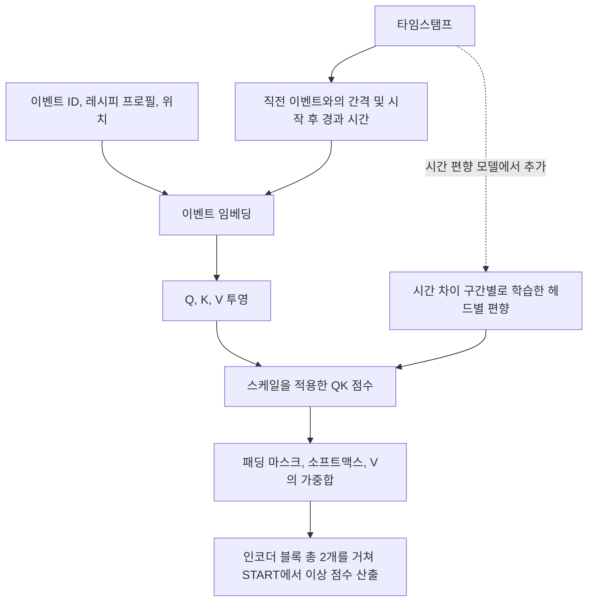

[English](README.md) · **한국어**

# Equip Triage


**검사 장비 로그의 판정 근거를 확인하고, 이벤트 순서 이상을 찾는 트랜스포머를 검증하는 프로젝트.**

장비 로그 CSV를 장비·LOT별로 재생하고, 중복·지연 도착·누락·충돌을 구분한다. 점검 후보나 판정 보류가 표시되면 해당 원본 행을 확인할 수 있다. 수율이나 제품 불량의 원인을 단정하기 전에 장비 기록부터 확인하는 용도다.

[실행 방법](#실행-방법) · [모델 구조](#모델-구조) · [벤치마크](#벤치마크) · [시간 간격 어텐션](#시간-간격-어텐션)


## 실행 방법

저장소 루트에서 Python 3.11 이상으로 실행한다. 로그 재생 앱은 별도 패키지 설치가 필요 없다.

```sh
python app.py --serve
python app.py --json
```

[한국어 화면](http://127.0.0.1:8765/?lang=ko) 또는 [영어 화면](http://127.0.0.1:8765/)에서 **SIM-A / LOT-001**을 선택하면 순번 6 누락과 순번 7 기록 충돌로 판정을 보류한 근거를 확인할 수 있다. 기본 입력은 [합성 예제](examples/events.csv)다. 다른 파일은 `python app.py --input path/to/events.csv --serve`로 실행한다. UTF-8과 `equipment,lot,sequence,time,code,memo` 헤더를 사용하며, 시각에는 UTC 오프셋이 필요하고 순번은 장비·LOT별로 1부터 시작한다.

Python/SQLite 기반 오프라인 재생 도구다. 실시간 데이터 수집이나 장비 제어를 하지 않으며, 화면에서 연구 모델을 호출하지 않는다.

## 모델 구조

| 구성 | 역할 |
| --- | --- |
| [이벤트 인코더](research/public-logbert/bert_mlm.py) | 이벤트 ID와 학습형 위치 임베딩을 입력으로 사용한다. 기본 구성은 블록 2개, 은닉 차원 32, 어텐션 헤드 4개다. Q/K/V 투영, 스케일 내적 어텐션, 패딩 마스크, GELU 피드포워드, 잔차 연결과 LayerNorm을 PyTorch 기본 연산으로 구성한다. |
| [마스킹 이벤트 헤드](research/public-logbert/bert_mlm.py) | 완료된 시퀀스의 앞뒤 문맥으로 가린 이벤트를 복원한다. 이벤트를 하나씩 가렸을 때의 평균 예측 손실을 이상 점수로 사용한다. 인코더는 랜덤 초기값부터 학습한다. |
| [순서 분류 헤드](research/order-aware/study.py) | `START`의 문맥 표현에 파라미터 33개짜리 선형 분류기를 붙인다. 정상 로그의 마스킹 복원과 정상·순서 교란 쌍의 이진 분류를 함께 학습한다. 추론은 시퀀스당 인코더를 한 번 통과한다. |
| [외부 비교 모델](research/external-comparison/README.md) | Google BERT-Tiny/Mini는 비교용 인코더, SmolLM2-135M-Instruct는 예시 4개를 제공하는 고정 가중치 디코더 모델이다. 자체 인코더 실행에는 두 계열의 모델이나 사전학습 가중치가 필요 없다. |

순서 분류 헤드의 검증 대상은 **이벤트 종류와 개수는 같지만 순서가 잘못된 경우**다. 양방향 인코더는 완료 로그를 사후 검토하고, 별도 인과형 기준 모델은 앞부분을 보고 다음 이벤트를 예측한다. 화면은 한국어를 지원하되, 인코더는 자연어가 아닌 이벤트 ID를 처리한다.

## 벤치마크


| 평가 조건 | 결과와 해석 |
| --- | --- |
| [합성 순서 오류 400쌍](research/order-aware/README.md) | 단순 횟수는 0/400건, 기존 마스킹 모델은 시드 3개에서 88~234/400건을 탐지한다. 순서 헤드를 추가하면 399~400/400건, 정상 400건 중 오경보 4~6건이다. 절차가 고정된 이 실험에서는 선후관계 규칙이 400/400건, 오경보 0건으로 앞선다. |
| [정상 절차 두 가지, 합성 192쌍](research/external-comparison/README.md) | 원본 시퀀스에서 자체 순서 헤드 3/192건, 사전학습 BERT-Mini 81/192건, SmolLM2 3/192건을 탐지한다(시드 42 비교). 정상 학습 로그로 정한 주요 단계 필터를 적용하면 자체 모델과 BERT-Mini 모두 192/192건, 오경보 0건이다. 선후 규칙은 같은 성능에 더 빠르다. 두 정상 절차 모두 학습에 포함되며, 새로운 정상 레시피가 아닌 오류 유형 하나만 분리한다. |
| [공개 Hadoop HDFS 블록 3만 건](research/public-logbert/RESEARCH.md) | 주 분할 AP는 횟수 기준선 0.9247, 마스킹 인코더 0.6517이다. 두 번째 분할에서도 횟수 기준선이 앞선다. 실제 IT 시스템 로그이며 제조 설비 로그는 아니다. |
| [합성 장비 세션 3만 건](research/v03/RESEARCH.md) | 상태기계+수치 규칙은 주입 이상 150/150건, 정상 오경보 0/2,850건이다. 인과형 트랜스포머+동일 수치 규칙은 Linux CPU 실행에서 150/150건, 오경보 98건이다. |

[벡터 그래프](docs/assets/external-benchmark.svg) · [지표 CSV](research/external-comparison/metrics.csv) · [합성 3만 건 노트북](notebooks/equip-triage-v03-30k.ipynb) · [데이터 출처](docs/EVALUATION.md)

**현재 결론:** 모델 크기를 키우기 전에 어떤 이벤트를 입력에 남길지 확인하는 편이 중요하다. 현재 검증 조건에서는 단순 규칙보다 순서 헤드가 우수하다는 근거가 없다. 실제 설비 탐지율이나 양산 수율 개선을 뜻하지 않는다.

## 시간 간격 어텐션

어떤 단계에서는 긴 대기가 정상이지만 다른 단계에서는 같은 대기가 오류다. 처음 보는 절차에서 인코더가 이 차이를 구별하는지 확인한다. 두 모델은 같은 이벤트, 레시피 프로필, 타임스탬프를 받는다. 입력 모델은 직전 이벤트와의 간격과 시작 후 경과 시간을 이벤트 임베딩에 더한다. 비교 모델은 이 입력을 그대로 사용하고, 두 이벤트의 시간 차이에 따라 학습한 헤드별 편향을 소프트맥스 직전 QK 점수에도 더한다.



합성 정상·오류 쌍은 이벤트별 횟수, 시간 간격 값과 각 값의 개수, 총 소요 시간이 같다. 시간 오류는 두 단계의 읽기 대기 시간만 맞바꿔 이벤트 순서까지 보존한다. 순서 오류는 필수 `ACK`를 `CLOSE` 뒤로 옮기고 **모든 타임스탬프**를 보존한다. 네 단계의 순열 24개를 절차 계열로 정의해 학습 16개, 검증 4개, 테스트 4개로 분리한다. 각 모델은 검증 정상 256건의 99백분위 점수를 초과할 때 경보를 낸다.

| 방식 | 시간 오류 탐지 / 128건 | 순서 오류 탐지 / 128건 | 정상 오경보 / 256건 |
| --- | ---: | ---: | ---: |
| 레시피·단계별 학습 규칙 | 128 | 128 | 0 |
| 시간 미사용 인코더 | 0 / 0 / 0 | 123 / 128 / 128 | 0 / 0 / 0 |
| 입력에만 시간 제공 | 1 / 5 / 4 | 128 / 128 / 123 | 1 / 11 / 10 |
| QK에만 시간 편향 적용 | 0 / 1 / 3 | 128 / 128 / 128 | 0 / 3 / 6 |
| 시간 입력과 QK 시간 편향 병용 | 0 / 3 / 1 | 127 / 128 / 121 | 0 / 5 / 2 |

슬래시로 구분한 값은 시드 41, 42, 43 순이다. 시간 입력에 QK 시간 편향을 추가하면 세 시드 모두 오경보가 줄지만 시간 오류 탐지도 줄어든다. 시드 42에서 오류에 짝을 이룬 정상보다 높은 점수를 준 경우도 시간 편향 추가 시 **57/128쌍**, 입력만 사용하면 **56/128쌍**이다. 단계별 규칙은 정상 학습 로그에서 허용 대기 시간과 이벤트 배열을 익힌다. 규칙이 전부 맞힌 결과는 단계별 조건이 고정된 합성 절차에서 얻은 값이다.

어텐션에 상대 위치를 반영한 연구와 시간 정보를 사용한 로그 이상 탐지 연구가 있다. 여기서는 미학습 절차의 짝지은 기록으로 시간 정보를 넣는 위치에 따른 차이를 검증한다. [Shaw 외 (2018)](https://aclanthology.org/N18-2074/) · [Gong 외, LogETA (2024)](https://doi.org/10.1016/j.future.2024.03.028)

[재현 명령 및 대조 실험](research/time-attention/README.md) · [계열별 건수·임계값·CPU 비용](research/time-attention/results.json)

[구현 상세](docs/IMPLEMENTATION.md) · [기여 안내](CONTRIBUTIONS.md) · [라이선스](LICENSE)

MIT 라이선스는 저장소 코드와 자체 합성 예제에 적용한다. 외부 데이터 및 가중치는 각 출처의 조건을 따른다.
