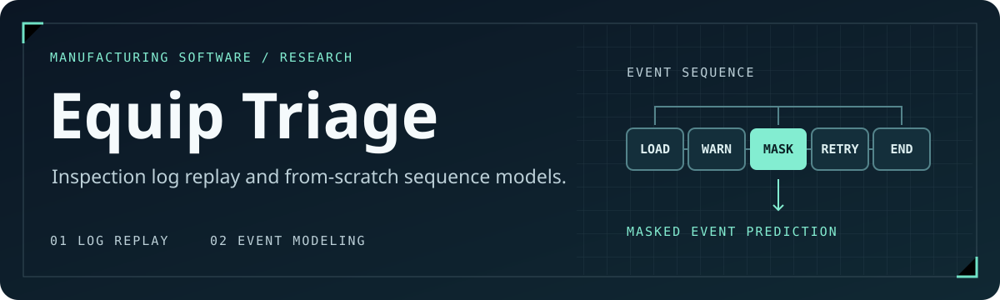
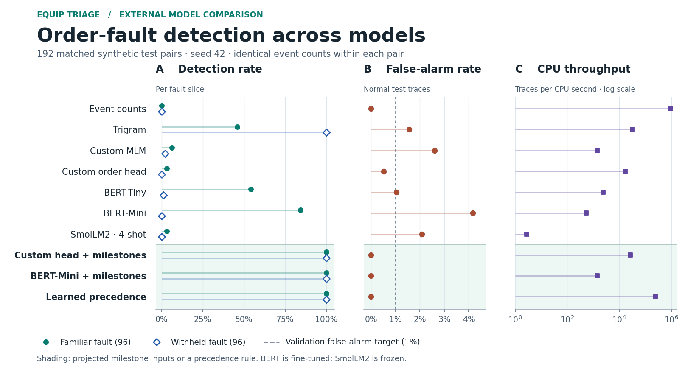

[English](README.md) · **한국어**



# Equip Triage: 검사 장비 로그 점검 도구

장비 로그를 장비·LOT별로 재생하고, 어떤 기록을 먼저 확인할지 원본 행과 함께 보여주는 로컬 데모다. 장비 통신 끊김, 순번 누락·충돌, 작업 메모 같은 단서를 보존한다. 제품 합격 여부나 고장 원인을 자동으로 확정하지 않는다.

## 한국어로 실행하기

Python 3.11 이상이면 별도 패키지 없이 앱을 실행할 수 있다.

```sh
python app.py --serve
```

브라우저에서 [한국어 로그 점검 화면](http://127.0.0.1:8765/?lang=ko)을 연다. 기본 주소에서는 영어로 시작하며, 화면 상단의 언어 전환을 누르면 선택한 장비·LOT을 유지한 채 영어와 한국어를 바꿀 수 있다. 예제 로그는 합성 데이터다. 종료하려면 터미널에서 Ctrl+C를 누른다.

```sh
python app.py --json
python app.py --input examples/events.csv --serve --port 8766
```

입력은 UTF-8 CSV이며 열 이름은 `equipment,lot,sequence,time,code,memo`다. 시각에는 UTC 오프셋 또는 `Z`가 필요하다. 앱은 CSV의 이벤트 코드, 원본 메모와 원본 기록 행을 보존한다. 메모에서 한국어 키워드를 찾아 점검 후보를 제시하지만 문장 전체의 의미를 이해하는 모델은 아니다. 근거가 없거나 기준이 겹치면 판단을 보류한다.

## 이벤트 순서 벤치마크



합성 로그 192쌍에서 정상과 이상은 이벤트 종류와 횟수가 같고 순서만 다르게 구성했다. 기존 자체 순서 모델은 3건, Google BERT-Mini는 81건, SmolLM2-135M은 예시 4개를 준 상태에서 3건을 잡았다. 정상 학습 로그를 기준으로 뽑은 주요 작업 단계만 남기면 **자체 모델과 BERT-Mini 모두 192건 탐지, 정상 오경보 0건**이었다. 단순한 선후관계 규칙 역시 동률이었고 처리량은 더 높았다.

정상 절차 두 가지는 모두 학습에 포함됐다. 이 결과는 제한된 생성 조건에서 입력 전처리가 효과적이었다는 뜻이며, 새 레시피나 생산현장 성능을 입증하지 않는다. [실험 설계·실행 명령](research/external-comparison/README.md) · [수치 CSV](research/external-comparison/metrics.csv) · [공개 HDFS 별도 실험](research/public-logbert/RESEARCH.md)

## 앱과 연구 모델의 범위

- **앱:** 원본 CSV를 메모리에서 재생한다. 실시간 수집, 장비 제어, SECS/GEM 연동, 수율 개선은 검증하지 않았다.
- **연구:** 직접 작성한 양방향 인코더는 한국어 문장이 아니라 **이벤트 ID 시퀀스**를 학습한다. 모델은 앱에 연결되어 있지 않다.
- **데이터:** 합성 장비 데이터와 공개 Hadoop HDFS 로그를 구분한다. 회사 로그와 외부 모델 가중치는 저장소에 없다.

[기술 구성](docs/IMPLEMENTATION.md) · [코드 라이선스](LICENSE)
