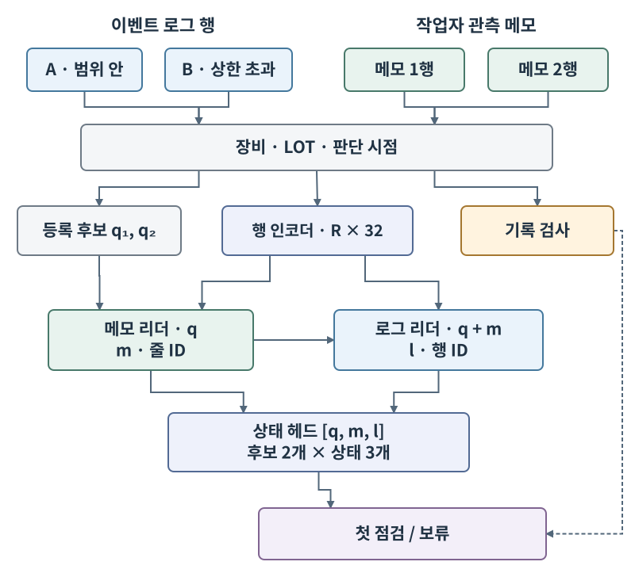
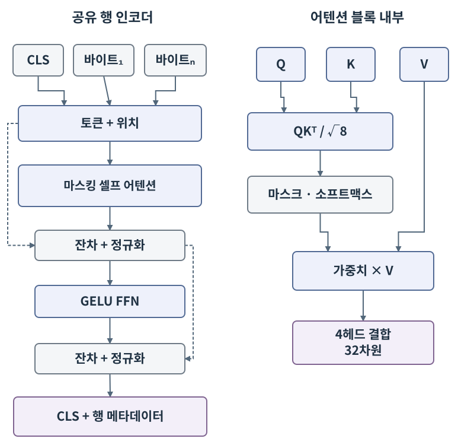
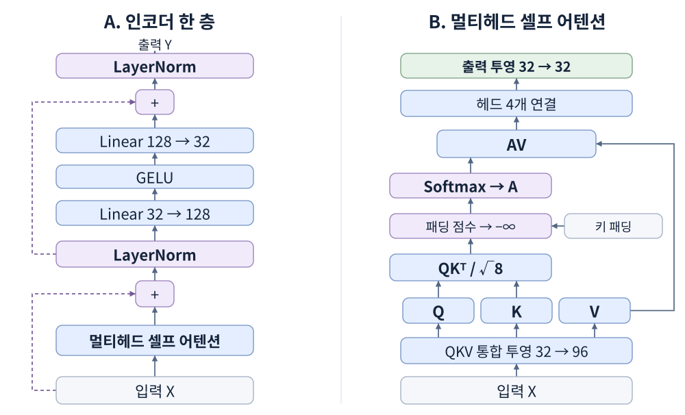

[English](README.md) · **한국어**

# Equip Triage

**장비 로그와 한·영 작업 메모를 함께 읽는 PyTorch 인코더와 오프라인 CSV 점검 도구입니다.** 결합 인코더는 등록된 점검 후보 두 개의 상태를 추정하고 각 상태를 뒷받침할 것으로 추정한 로그 행과 메모 줄의 ID를 반환합니다. CSV 뷰어는 장비·LOT별 순서와 원본 기록을 보여 줍니다.

[결합 인코더](#로그메모-결합-인코더) · [로그 화면](#csv-로그-검토) · [메모 모델 실행](#메모-모델-실행) · [구조도](#트랜스포머-구조) · [Python API](docs/MEMO_MODEL.md) · [검증 기록](docs/EVALUATION.md)

## 로그·메모 결합 인코더

**연구용 프리뷰입니다.** 결합 모델은 아직 기준선을 넘지 못했습니다. 결합 모델의 권장 가중치는 배포하지 않습니다.

저장소 루트에서 작은 체크포인트를 학습한 뒤 `equip_triage.joint`로 합성 예제를 판독할 수 있습니다.

```sh
python -m pip install . scikit-learn==1.8.0
python -m research.joint_encoder.run --profile pilot --work artifacts/joint-pilot prepare
python -m research.joint_encoder.run --profile pilot --work artifacts/joint-pilot fit --arm joint --device cpu --microbatch 4
python -m equip_triage.joint --model artifacts/joint-pilot/models/joint-17/model.pt --input examples/joint-observations.jsonl
```

판단 시점까지 해당 장비·LOT에서 관측되고 수신된 기록을 모읍니다. 등록 행은 점검 후보 두 개를 정합니다. 각 후보의 쿼리가 먼저 메모를 읽고, 그 결과를 이용해 로그 행을 찾습니다. 공유 헤드가 지속·해소·불명을 추정합니다. 순번 누락, 원본 기록 충돌, 관측 누락·기한 초과가 있으면 별도 정책이 점검을 보류합니다. [입력 형식·텐서 API·반환값](docs/JOINT_ENCODER.md) · [Colab 학습·재개·비교 노트북](notebooks/equip-triage-joint-colab.ipynb)



[편집 가능한 전체 구조도 · 한글/영문](docs/assets/joint-overview.drawio)

### 결합 인코더 한 층



모든 행에 같은 인코더를 쓰고, 각 행의 벡터에 출처 종류·후보 위치·경과 시간·순서를 더합니다. 어느 원본 행이 근거인지 지도학습하며 근거를 선택하지 않은 경우도 출력에 남깁니다. [편집 가능한 상세도](docs/assets/joint-encoder.drawio) · [구현 코드](equip_triage/joint/model.py)

합성 기록 288건의 CPU 파일럿에서 첫 점검 macro-F1은 영어 0.228, 한국어 0.214였습니다. 같은 자료에서 규칙은 두 언어 모두 1.000, 문자·이벤트 기준선은 0.623과 0.641이었습니다. 결합 인코더가 정답 로그 행을 찾은 건수는 양 언어 각각 248건 중 116건입니다. 현장 성능과 신규 결합 모델의 본 규모 CUDA 성능은 아직 측정되지 않았습니다. [비교 수치와 한계](research/joint_encoder/REPORT.md)

## CSV 로그 검토

Python 3.11 이상에서 별도 패키지 설치 없이 실행할 수 있습니다.

```sh
python app.py --serve
```

[한국어 화면](http://127.0.0.1:8765/?lang=ko)에서 `SIM-A / LOT-001`을 열면 순번 6 누락과 순번 7 충돌을 확인할 수 있습니다. CSV 열은 `equipment,lot,sequence,time,code,memo`이며, [예제 CSV](examples/events.csv)가 기본값입니다. 내 파일은 `python app.py --input path/to/events.csv --serve`로 열 수 있습니다. `python app.py --json`은 같은 검토 결과를 JSON으로 출력합니다.

CSV 뷰어는 기존 재생 로직과 메모 키워드 규칙을 사용합니다. 결합 API의 JSONL에는 자료 수신 시점, 등록 후보와 채널 관측값이 필요합니다. 아래 메모 전용 모델은 등록된 후보와 메모 두 줄을 입력으로 받습니다.

## 메모 모델 실행

Python 3.11 이상에서 저장소 루트의 가상 환경을 활성화한 뒤 설치하고 실행합니다.

```sh
python -m pip install .
python -m equip_triage predict --model models/memo-demo.pt --input examples/memo-input.jsonl
```

[데모 가중치](models/memo-demo.pt)는 합성 기록 72건으로 만든 실행 확인용입니다. 예제의 출력은 `data`, `data`, `hold`, `hold`, `hold`입니다. [체크섬](models/SHA256SUMS)

```sh
python -m equip_triage train --data examples/memo-train.jsonl --out artifacts/memo.pt
```

이 명령으로 무작위 초기값에서 다시 학습할 수 있습니다. 현장 성능은 확인하지 않았습니다.

## 트랜스포머 구조


두 메모 줄은 따로 인코딩하며 같은 가중치를 씁니다. Q/K/V 투영, 패딩을 제외하는 양방향 어텐션, 두 잔차 연결, 층 정규화, GELU 피드포워드 층을 PyTorch로 직접 구현했습니다. 점검 후보마다 쿼리 하나를 만들어 등록 정보로 연결된 줄의 메모 토큰만 읽게 하고, 같은 분류기로 각 후보의 세 상태를 예측합니다. 마지막 점검 선택은 지속 건수와 점수 임계값으로 결정합니다. [편집 가능한 draw.io 원본 · 한글/영문 두 페이지](docs/assets/memo-transformer.drawio) · [모델 코드](equip_triage/model.py) · [도식 구성에 참고한 BERT 논문 그림 1](https://aclanthology.org/N19-1423.pdf#page=3)

```python
import json
from pathlib import Path
from equip_triage import load_checkpoint, predict

model = load_checkpoint("models/memo-demo.pt")
packet = json.loads(Path("examples/memo-input.jsonl").read_text(encoding="utf-8").splitlines()[1])
logits, attention = model(model.encode([packet]), return_attention=True)
print(predict(model, packet)["action"])  # data
```

[API, 텐서 차원, 체크포인트 형식, 직접 만든 데이터로 학습하는 방법](docs/MEMO_MODEL.md)

### 인코더 한 층 자세히 보기



왼쪽 점선은 입력을 그대로 더하는 잔차 연결입니다. 덧셈 뒤에 LayerNorm을 적용합니다. 오른쪽은 셀프 어텐션을 펼친 것으로, 토큰마다 32차원인 입력을 한 번에 96차원으로 투영한 뒤 Q·K·V로 나눕니다. 각각 헤드 4개 × 8차원이고, 패딩 위치의 **키 점수**를 Softmax 전에 제외합니다. 앞뒤 순서를 가리는 인과 마스크는 쓰지 않습니다. 메모 두 줄은 같은 인코더를 쓰되 서로 섞이지 않습니다.

[인코더 코드](equip_triage/model.py#L39-L65) · [편집 가능한 draw.io 원본 · 한글/영문](docs/assets/memo-encoder.drawio) · [설계 참고: Transformer 원논문 그림 1·2](https://arxiv.org/pdf/1706.03762#page=3)

## 검증 기록

실행 검증과 낯선 표현에서의 성능은 별개입니다. [검증 기록](docs/EVALUATION.md)에서 이전 모델의 수치와 당시 코드·데이터 조건을 확인할 수 있습니다. 라이선스는 [MIT](LICENSE)입니다.
