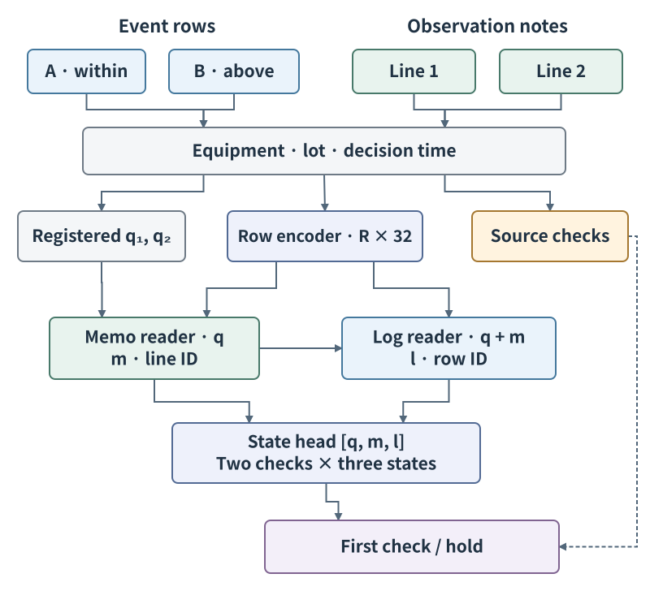
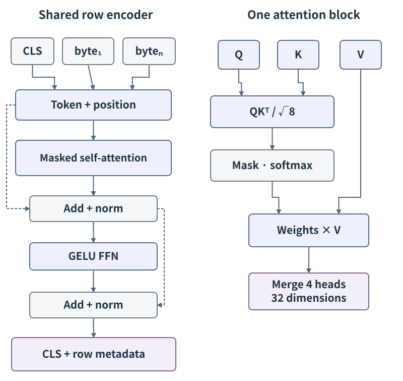
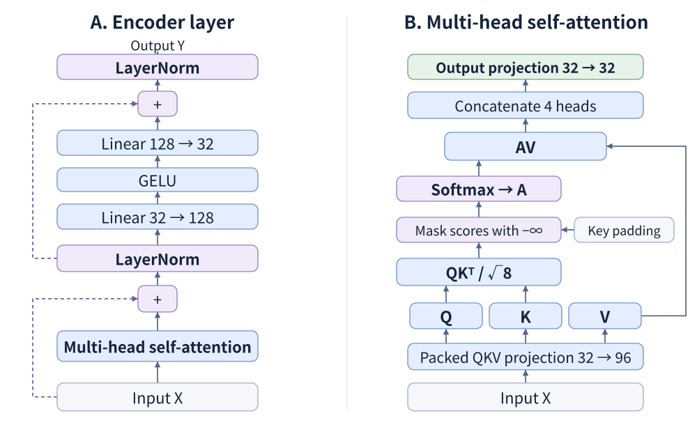

**English** · [한국어](README.ko.md)

# Equip Triage

**A native PyTorch encoder for equipment logs and English or Korean work notes, alongside an offline CSV replay viewer.** For two registered checks, the joint encoder estimates which issue continues and predicts which log row and memo line support each state. The viewer reconstructs equipment/lot sequences and displays source records.

[Joint encoder](#joint-log-and-memo-encoder) · [Log viewer](#csv-log-review) · [Run the memo model](#run-the-memo-model) · [Architecture](#transformer-architecture) · [Python API](docs/MEMO_MODEL.md) · [Evaluation archive](docs/EVALUATION.md)

## Joint log and memo encoder

**Research preview.** The joint encoder has not passed the baseline comparison. No joint checkpoint is recommended or shipped.

Train a small local checkpoint and run the reusable `equip_triage.joint` API from the checkout.

```sh
python -m pip install . scikit-learn==1.8.0
python -m research.joint_encoder.run --profile pilot --work artifacts/joint-pilot prepare
python -m research.joint_encoder.run --profile pilot --work artifacts/joint-pilot fit --arm joint --device cpu --microbatch 4
python -m equip_triage.joint --model artifacts/joint-pilot/models/joint-17/model.pt --input examples/joint-observations.jsonl
```

The cutoff selects observations available for that equipment and lot. Registration rows identify the two candidates. A query for each check first reads its memo lines, then uses that representation to search its log rows. The shared state head predicts continuing, cleared or unknown. Gaps, source conflicts and missing or stale observations trigger a separate hold decision. [Schema, tensor API and output fields](docs/JOINT_ENCODER.md) · [Self-contained Colab training and comparison](notebooks/equip-triage-joint-colab.ipynb)



[Editable architecture, English and Korean](docs/assets/joint-overview.drawio)

### Inside the joint encoder



The model shares the same encoder across rows. It adds modality, registered slot, age and within-stream order to each row vector. Source pointers are trained against original log and memo IDs and can return an empty result. [Editable layer detail](docs/assets/joint-encoder.drawio) · [Implementation](equip_triage/joint/model.py)

On a 288-record synthetic CPU pilot, the conditioned encoder's first-check macro-F1 was 0.228 in English and 0.214 in Korean. A scoped rule reached 1.000 in both languages, and character/event features reached 0.623 and 0.641. The native reader identified the correct log row in 116 of 248 annotated cases per language. The field and full joint CUDA comparison have no measured results in this release. [Metrics and limitations](research/joint_encoder/REPORT.md)

## CSV log review

Run on Python 3.11 or newer. The viewer needs no third-party dependencies.

```sh
python app.py --serve
```

Open the [local viewer](http://127.0.0.1:8765/) and select `SIM-A / LOT-001` to see missing sequence 6 and conflicting records at sequence 7. The columns are `equipment,lot,sequence,time,code,memo`. The [sample CSV](examples/events.csv) runs by default. Use `python app.py --input path/to/events.csv --serve` for another file or `python app.py --json` for machine-readable output.

The CSV viewer uses its existing replay and keyword rules. The joint API accepts cutoff-aware JSONL with source availability, registered candidates and channel readings. The original memo-only API below accepts a registry and two note lines. Each entry point has its own input contract.

## Run the memo model

In an activated Python 3.11+ environment, install and run from the checkout:

```sh
python -m pip install .
python -m equip_triage predict --model models/memo-demo.pt --input examples/memo-input.jsonl
```

The [demo checkpoint](models/memo-demo.pt) is a smoke test trained on 72 synthetic records. The five example decisions are `data`, `data`, `hold`, `hold`, `hold`. [Checksum](models/SHA256SUMS)

```sh
python -m equip_triage train --data examples/memo-train.jsonl --out artifacts/memo.pt
```

This command retrains from random initialization. Performance on real equipment is unverified.

## Transformer architecture


Each memo line gets its own bidirectional context. The encoder implements Q/K/V projections, padding-masked attention, two residual additions, layer normalization and a GELU feed-forward layer in PyTorch. The task-specific readout builds one query per registered check. It restricts that query to the matched line’s memo tokens and uses one shared head to predict three states. The final count and confidence check are deterministic. The diagram’s two panels show supervised state training and inference with the resulting checkpoint. [Editable draw.io source, English and Korean pages](docs/assets/memo-transformer.drawio) · [Model code](equip_triage/model.py) · [BERT Figure 1, visual reference](https://aclanthology.org/N19-1423.pdf#page=3)

```python
import json
from pathlib import Path
from equip_triage import load_checkpoint, predict

model = load_checkpoint("models/memo-demo.pt")
packet = json.loads(Path("examples/memo-input.jsonl").read_text(encoding="utf-8").splitlines()[0])
logits, attention = model(model.encode([packet]), return_attention=True)
print(predict(model, packet)["action"])  # data
```

[API, tensor shapes, checkpoint format and custom training data](docs/MEMO_MODEL.md)

### Inside one encoder layer



The dashed paths carry the unchanged inputs to the two residual additions. Layer normalization follows each addition. On the right, one projection maps each 32-dimensional token vector to 96 values before splitting into Q, K and V, each with four 8-dimensional heads. The mask removes padded **keys** before softmax; it does not block future positions. The two memo lines use the same encoder weights but attend within their own lines.

[Encoder code](equip_triage/model.py#L39-L65) · [Editable draw.io source, English and Korean](docs/assets/memo-encoder.drawio) · [Design reference: Transformer paper, Figures 1–2](https://arxiv.org/pdf/1706.03762#page=3)

## Evaluation archive

The supplied demo verifies the execution path, not accuracy on unseen workplace text. [Archived evaluations](docs/EVALUATION.md) preserve results, controls, and the exact source snapshot. [MIT licensed](LICENSE).
