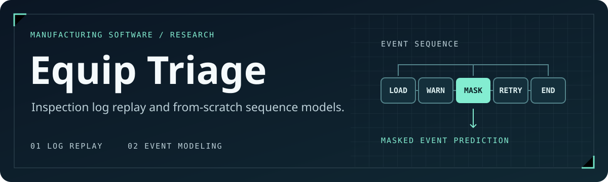

[](#quickstart)
[](LICENSE)
[](https://colab.research.google.com/github/ArialHanho/equip-triage/blob/c08386f3c4d0c7425a5dd8e7e60b259aa575628e/notebooks/equip-triage-v03-30k.ipynb)

Replay inspection logs without losing the original evidence. Then test whether **an encoder built from scratch** can recognize unusual event context that simpler methods miss.

## What belongs in software, and what belongs in a model?

| Layer | Responsibility | Status |
| --- | --- | --- |
| **Log replay** | Parse CSV, preserve source rows, canonicalize timestamps to UTC, isolate equipment/lot streams, and flag duplicates, gaps, or conflicts. | Runnable local app using Python and SQLite. |
| **Sequence baselines** | Learn normal event order with a trigram and a hand-built causal Transformer. Compare both with an explicit state machine and shared timing/sequence rules. | Evaluated on 30,000 synthetic sessions. |
| **BERT-style encoder** | Implement token and position embeddings, multi-head Q/K/V attention, feed-forward layers, residuals, normalization, and a masked-event head. Train from random initialization. | Separate research track; the synthetic causal scores below are not BERT results. |

The causal model predicts the **next event from its prefix**. The BERT-style objective reconstructs a **masked event using both sides** of a completed sequence. The latter is for retrospective triage, not live alarms or online early detection. Event IDs are the tokens; this is not a Korean language model. Neither research model is wired to the replay app. No pretrained checkpoints are required.

## Quickstart

From the repository root, use Python 3.11+; the replay app has no external dependencies.

```sh
python app.py --serve
```

Open [localhost:8765](http://127.0.0.1:8765/). Stop with Ctrl+C. The bundled CSV is synthetic. Rows for the same lot ID on different machines stay separate; select a flagged stream to inspect the original record.

```sh
python app.py --json
python app.py --input examples/events.csv --serve --port 8766
python -m unittest discover -s tests -v
```

The CSV header is `equipment,lot,sequence,time,code,memo`. Use UTF-8, an offset-aware timestamp (or `Z`), and sequence numbers starting at 1 for each equipment/lot pair. The app replays a file into an in-memory database; it is not a live collector, permanent historian, or equipment controller.

## Measured: 30,000 synthetic equipment sessions

24,000 normal train sessions, 3,000 validation, 3,000 test; 766,290 event rows total. The test set has 150 injected anomalies and 2,850 normal sessions. Fix each threshold on validation normals (target false-alarm rate ≤1%), then apply it unchanged to test.

| Method | Test AP ↑ | Anomalies caught ↑ | False alarms ↓ |
| --- | ---: | ---: | ---: |
| Trigram, events only | 0.2924 | 38/150 | 0/2,850 |
| Causal Transformer, events only | 0.5063 | 70/150 | 98/2,850 |
| Trigram + shared numeric rules | 0.8315 | 123/150 | 0/2,850 |
| Causal Transformer + shared numeric rules | 1.0000 | 150/150 | 98/2,850 |
| State machine + numeric rules | 1.0000 | 150/150 | 0/2,850 |

These are the [committed Linux CPU results](research/v03/results-30k.json). The Colab CPU run reproduced the AP and recall shown here with 97 Transformer false alarms instead of 98. **The state machine performed best at the chosen operating point.** It knows the generator grammar; the Transformer ranked this synthetic test perfectly with numeric rules but still fired on normal sessions at the threshold chosen on validation. That is not evidence of a production yield gain or field accuracy. See the [experiment protocol](research/v03/RESEARCH.md).

## Public data: what it can establish

[LogHub HDFS v1](https://github.com/logpai/loghub/tree/master/HDFS) contains labeled Hadoop block traces. It can test event-sequence methods on real system logs, not on semiconductor equipment. [UCI SECOM](https://archive.ics.uci.edu/dataset/179/secom) contains manufacturing measurements and pass/fail labels, not equipment event sequences or operator notes. Treat it as a separate tabular task. See [research sources and evaluation criteria](docs/EVALUATION.md).

## Repository map

- [Project index](INDEX.md) · [Original causal and memo baselines](research/RESEARCH.md) · [Contribution guide](CONTRIBUTIONS.md)
- [30K experiment code](research/v03/scale_pilot.py) · [Notebook](notebooks/equip-triage-v03-30k.ipynb) · [Results](research/v03/results-30k.json)

MIT applies to repository code and original synthetic fixtures, not third-party datasets. No proprietary manufacturing data, live equipment integration, or production validation is included.
