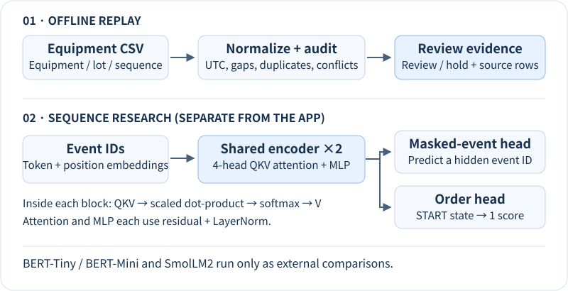
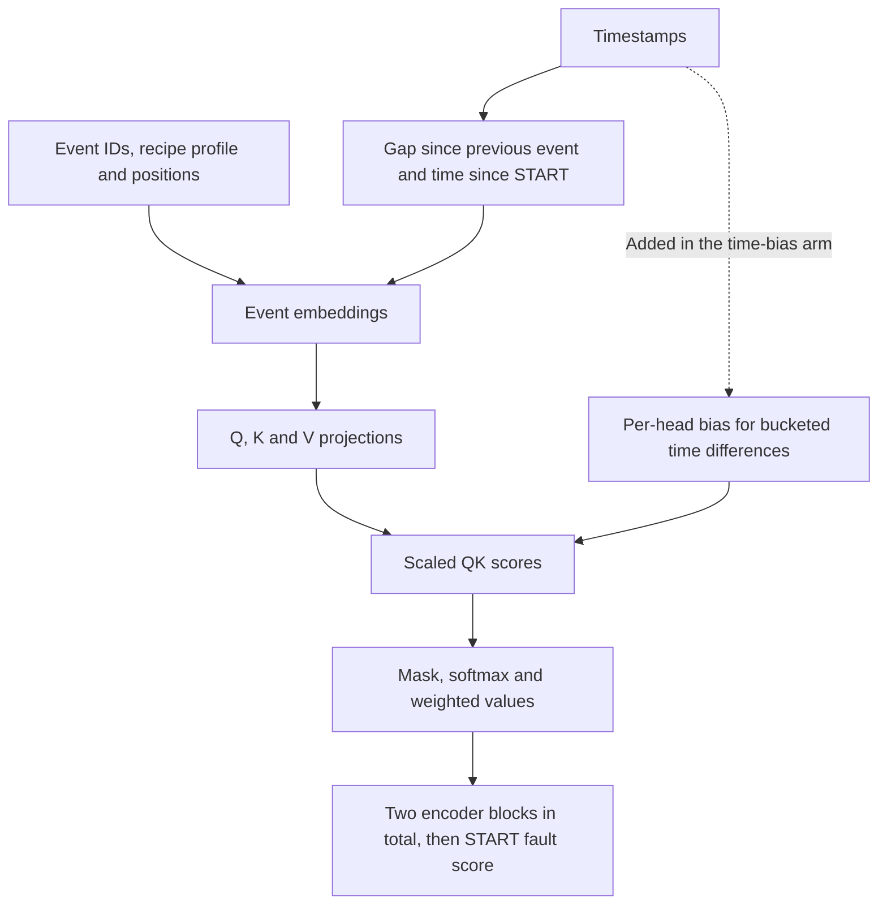

**English** · [한국어](README.ko.md)

# Equip Triage

Equip Triage includes a **BERT-style Transformer implemented in native PyTorch for English and Korean equipment memos**. Give it two registered checks and two memo lines. It estimates whether each issue continues, has cleared, or has an unknown outcome. It selects a check when exactly one issue continues and the other has cleared. The result includes the state, score and source line for each candidate.

[Train and run](#train-and-run) · [Transformer architecture](#transformer-architecture) · [Python API](docs/MEMO_MODEL.md) · [CSV replay](#csv-replay) · [Supporting evidence](#supporting-evidence)

## Train and run

Run the included [demo checkpoint](models/memo-demo.pt) with Python 3.11+ and PyTorch:

```sh
python -m equip_triage predict --model models/memo-demo.pt --input examples/memo-input.jsonl
```

The checkpoint is a **72-record synthetic smoke test**, not the benchmark model or a production release. [SHA-256](models/SHA256SUMS)

From the checkout with Python 3.11+ and PyTorch installed, run:

```sh
python -m equip_triage train --data examples/memo-train.jsonl --out artifacts/memo.pt
python -m equip_triage predict --model artifacts/memo.pt --input examples/memo-input.jsonl
```

The first command trains from random weights on 72 original synthetic packets. The second loads the saved weights and runs the Transformer offline. The five example actions at seed 42 are `data`, `data`, `hold`, `hold`, `hold`. The inputs reuse training phrases to demonstrate both languages, two continuing issues, an unknown reading and a missing line. The confidence cutoff of 0.50 is a fixture setting. [Training records](examples/memo-train.jsonl) · [Input records](examples/memo-input.jsonl)

## Transformer architecture


Each memo line gets its own bidirectional context. The encoder implements Q/K/V projections, padding-masked attention, two residual additions, layer normalization and a GELU feed-forward layer in PyTorch. The task-specific readout builds one query per registered check. It restricts that query to the matched line’s memo tokens and uses one shared head to predict three states. The final count and confidence check are deterministic. The diagram’s two panels show supervised state training and inference with the resulting checkpoint. [Editable draw.io source, English and Korean pages](docs/assets/memo-transformer.drawio) · [Model code](equip_triage/model.py) · [BERT Figure 1, visual reference](https://aclanthology.org/N19-1423.pdf#page=3)

```python
import json
from pathlib import Path
from equip_triage import load_checkpoint, predict

model = load_checkpoint("artifacts/memo.pt")
packet = json.loads(Path("examples/memo-input.jsonl").read_text(encoding="utf-8").splitlines()[0])
logits, attention = model(model.encode([packet]), return_attention=True)
print(predict(model, packet)["action"])  # data
```

[API, tensor shapes, checkpoint format and custom training data](docs/MEMO_MODEL.md)

### Inside one encoder layer


The dashed paths carry the unchanged inputs to the two residual additions. Layer normalization follows each addition. On the right, one projection maps each 32-dimensional token vector to 96 values before splitting into Q, K and V, each with four 8-dimensional heads. The mask removes padded **keys** before softmax; it does not block future positions. The two memo lines use the same encoder weights but attend within their own lines.

[Encoder code](equip_triage/model.py#L39-L65) · [Editable draw.io source, English and Korean](docs/assets/memo-encoder.drawio) · [Design reference: Transformer paper, Figures 1–2](https://arxiv.org/pdf/1706.03762#page=3)

## CSV replay

From the repository root, run with Python 3.11+; the replay app requires no external dependencies.

```sh
python app.py --serve
python app.py --json
```

Open the [English dashboard](http://127.0.0.1:8765/) or [한국어](http://127.0.0.1:8765/?lang=ko). Select **SIM-A / LOT-001** to inspect why the app returns **Hold**: sequence 6 is missing and two records disagree at sequence 7. The input is a [synthetic fixture](examples/events.csv). For another file, use `python app.py --input path/to/events.csv --serve` with UTF-8 and columns `equipment,lot,sequence,time,code,memo`. Timestamps need a UTC offset and each equipment/lot stream starts at sequence 1.

The app is an offline Python/SQLite replay, not a live collector or controller. The UI and evidence review do not invoke a research model.

## Supporting evidence

The studies below retain their original models, tokenizers and evaluation protocols. In the frozen memo study, the candidate-query BERT recovered 0/112 matched pairs in each language at all three seeds. The package smoke run above measures train/save/load behavior on familiar phrasing. [Frozen memo report](research/candidate-states/REPORT.md)

### Event models



| Component | Role |
| --- | --- |
| [Event encoder](research/public-logbert/bert_mlm.py) | Discrete event IDs plus learned position embeddings; two Transformer blocks by default, width 32 and four attention heads. The repository implements Q/K/V projection, scaled dot-product attention with padding masking, and residual/LayerNorm around attention and the GELU feed-forward block using PyTorch primitives. |
| [Masked-event head](research/public-logbert/bert_mlm.py) | Predict a hidden event from both sides of a completed sequence; score anomalies by mean leave-one-out prediction loss. Train the reference encoder from random initialization. |
| [Order head](research/order-aware/study.py) | Add a 33-parameter linear scorer to the contextual `START` vector. Train with masked-event loss on normal sequences and binary classification on matched normal/reordered pairs; score a sequence in one encoder pass. |
| [External models](research/external-comparison/README.md) | Google BERT-Tiny/Mini act as comparison encoders; frozen SmolLM2-135M-Instruct is a four-shot decoder-only comparison. The project encoder requires neither model nor a pretrained checkpoint. |

The order head targets **illegal order with unchanged event counts**. The bidirectional model looks at completed sequences for retrospective review; the separate causal baseline predicts the next event from its prefix. Event IDs are not natural-language tokens. The dashboard supports Korean text, but the sequence encoder is not a Korean language model or an LLM.

### Bilingual memo routing

When one check still fails and a second check has recovered, the memo can support a single inspection. If both still fail, it calls for review. The offline memo experiment reads two registered checks and two lines of English or Korean. It predicts **continues, cleared or unknown** for each candidate and routes only when one continues and the other is cleared.

[Example figure from the earlier experiment](docs/assets/candidate-states-en.svg)

The figure shows the implemented scratch BERT arm using the **expected states** for an example. The model encodes each line separately and restricts candidate-query attention to evidence matched by the visible registry. A uniform-pooling control reads the same tokens. Target-conditioned reading and label queries have prior examples. [Wang et al., 2016](https://aclanthology.org/D16-1058/) · [Liu et al., 2021](https://arxiv.org/abs/2107.10834)

| Method | One vs two continuing checks, EN | One vs two continuing checks, KO | Macro-F1, EN / KO |
| --- | ---: | ---: | ---: |
| Scoped bilingual rule | 70/112 | 98/112 | 0.803 / 0.942 |
| Character TF-IDF, candidate’s matched line | 35/112 | 83/112 | 0.510 / 0.858 |
| Scratch BERT, masked candidate queries | 0/112 | 0/112 | 0.170 / 0.170 |

Both decisions in a pair must be correct. The fresh synthetic challenge holds out eight wording families. The validation-selected default is the character model. It passes 16/624 English gold holds and 0/624 Korean gold holds to a check. The rule performs best on the challenge. The query encoder holds every case at its selected operating point at all three seeds. The measured benefit comes from predicting states per candidate and counting continuing checks in the character model; learned attention shows no gain here. [Run the bilingual CLI](research/candidate-states/README.md) · [Ablations, uncertainty and coverage](research/candidate-states/REPORT.md)

### Benchmarks


| Evaluation | Result and scope |
| --- | --- |
| [400 synthetic order-fault pairs](research/order-aware/README.md) | Event counts detect 0/400. The original masked model detects 88–234/400 across three seeds; adding the order head yields 399–400/400 with 4–6 false alerts on 400 normals. The learned precedence rule yields 400/400 and zero false alerts on this fixed grammar. |
| [192 synthetic pairs: two valid workflows](research/external-comparison/README.md) | Raw traces: custom order head 3/192, pretrained BERT-Mini 81/192 and frozen SmolLM2 3/192 (seed 42 comparison). A normal-train-only milestone filter brings the custom encoder and BERT-Mini to 192/192 with zero false alerts, matching the faster precedence rule. Both valid workflows are already present during training. Only one fault type is withheld, not a normal recipe. |
| [30,000 public Hadoop HDFS blocks](research/public-logbert/RESEARCH.md) | In the main split, the count baseline reaches AP 0.9247 versus 0.6517 for the masked encoder; counts also lead on the second split. HDFS is authentic IT telemetry, not factory equipment data. |
| [30,000 synthetic equipment sessions](research/v03/RESEARCH.md) | The state machine plus numeric rules detects 150/150 injected faults with 0/2,850 false alerts; the causal Transformer plus the same numeric rules detects 150/150 with 98 false alerts in the Linux CPU run. |

[Vector chart](docs/assets/external-benchmark.svg) · [Metrics CSV](research/external-comparison/metrics.csv) · [30K synthetic notebook](notebooks/equip-triage-v03-30k.ipynb) · [Data provenance](docs/EVALUATION.md)

**Finding:** The choice of event representation can matter more than the model. Neither the order head nor the milestone filter shows an advantage over a simple rule on the tested grammar. No industrial detection or yield claim follows from these experiments.

### Time-gap attention

A long wait is legal at one stage and anomalous at another. Can an encoder tell them apart on an unseen procedure when it receives the same events, recipe profile and timestamps? The offline experiment compares two places to use the clock. One adds the preceding gap and elapsed time to each event embedding. The other keeps those inputs and also adds a learned, per-head bias for the signed time difference between events to each QK score before softmax.



Each synthetic pair has the same event counts, gap multiset and total duration. For a timing fault, two stage-to-read intervals exchange places and the event sequence stays identical. For an order fault, a required `ACK` moves after `CLOSE` and **every timestamp** stays identical. Four-stage orderings define 24 procedure families. Training uses 16 families, threshold calibration uses four different families, and testing uses the remaining four. Each model raises an alert above its own 99th percentile on 256 validation normals.

| Method | Timing faults detected / 128 | Order faults detected / 128 | False alerts / 256 normals |
| --- | ---: | ---: | ---: |
| Recipe- and stage-conditioned rule | 128 | 128 | 0 |
| Encoder without timestamps | 0 / 0 / 0 | 123 / 128 / 128 | 0 / 0 / 0 |
| Time at the input | 1 / 5 / 4 | 128 / 128 / 123 | 1 / 11 / 10 |
| Time in QK only | 0 / 1 / 3 | 128 / 128 / 128 | 0 / 3 / 6 |
| Time at the input and in QK | 0 / 3 / 1 | 127 / 128 / 121 | 0 / 5 / 2 |

Entries separated by slashes give seeds 41, 42 and 43 in order. Adding the QK time bias to the timed input reduces false alerts at every seed and detects fewer timing faults at every seed. At seed 42, it scores the fault higher than its matched normal in just **57/128** timing pairs, compared with **56/128** for input alone. The stage rule learns the allowed read intervals and event patterns from training normals. Its perfect result reflects the generator’s fixed stage grammar. All measurements here use invented equipment procedures.

Relative position in attention and time-aware log detection both have prior examples. This study tests where to supply timestamps under a paired procedure holdout. [Shaw et al. (2018)](https://aclanthology.org/N18-2074/) · [Gong et al., LogETA (2024)](https://doi.org/10.1016/j.future.2024.03.028)

[Run the experiment and inspect the controls](research/time-attention/README.md) · [Per-family counts, thresholds and CPU timings](research/time-attention/results.json)

[Implementation notes](docs/IMPLEMENTATION.md) · [Contribution guide](CONTRIBUTIONS.md) · [License](LICENSE)

MIT covers repository code and original synthetic fixtures, not third-party data or checkpoints.
