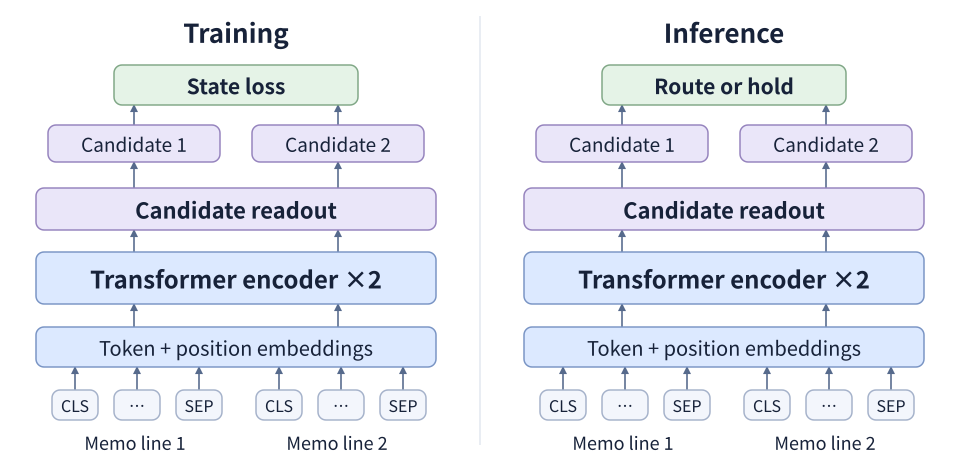

**English** · [한국어](README.ko.md)

# Equip Triage

**An offline inspection tool for reviewing equipment events and operator notes together.** The CSV viewer reconstructs each equipment/lot sequence and surfaces gaps and conflicts next to the original notes. The repository also includes a BERT-style Transformer implemented in native PyTorch for interpreting Korean and English notes.

[Log viewer](#csv-log-review) · [Run the memo model](#run-the-memo-model) · [Architecture](#transformer-architecture) · [Python API](docs/MEMO_MODEL.md) · [Evaluation archive](docs/EVALUATION.md)

## CSV log review

Run on Python 3.11 or newer. The viewer needs no third-party dependencies.

```sh
python app.py --serve
```

Open the [local viewer](http://127.0.0.1:8765/) and select `SIM-A / LOT-001` to see missing sequence 6 and conflicting records at sequence 7. The columns are `equipment,lot,sequence,time,code,memo`. The [sample CSV](examples/events.csv) runs by default. Use `python app.py --input path/to/events.csv --serve` for another file or `python app.py --json` for machine-readable output.

**Integration boundary:** The viewer shows events and original notes together and checks codes and memo keywords with rules. The Transformer runs separately. It reads two registered checks and two lines, then estimates whether each issue continues, has cleared, or is unknown. The Transformer does not take the CSV event sequence as input, and the two paths do not share a final decision.

## Run the memo model

In an activated Python 3.11+ environment, install and run from the checkout:

```sh
python -m pip install .
python -m equip_triage predict --model models/memo-demo.pt --input examples/memo-input.jsonl
```

The [demo checkpoint](models/memo-demo.pt) is a smoke test trained on 72 synthetic records. The five example decisions are `data`, `data`, `hold`, `hold`, `hold`. [Checksum](models/SHA256SUMS)

```sh
python -m equip_triage train --data examples/memo-train.jsonl --out artifacts/memo.pt
```

This command retrains from random initialization. Performance on real equipment is unverified.

## Transformer architecture



Each memo line gets its own bidirectional context. The encoder implements Q/K/V projections, padding-masked attention, two residual additions, layer normalization and a GELU feed-forward layer in PyTorch. The task-specific readout builds one query per registered check. It restricts that query to the matched line’s memo tokens and uses one shared head to predict three states. The final count and confidence check are deterministic. The diagram’s two panels show supervised state training and inference with the resulting checkpoint. [Editable draw.io source, English and Korean pages](docs/assets/memo-transformer.drawio) · [Model code](equip_triage/model.py) · [BERT Figure 1, visual reference](https://aclanthology.org/N19-1423.pdf#page=3)

```python
import json
from pathlib import Path
from equip_triage import load_checkpoint, predict

model = load_checkpoint("models/memo-demo.pt")
packet = json.loads(Path("examples/memo-input.jsonl").read_text(encoding="utf-8").splitlines()[0])
logits, attention = model(model.encode([packet]), return_attention=True)
print(predict(model, packet)["action"])  # data
```

[API, tensor shapes, checkpoint format and custom training data](docs/MEMO_MODEL.md)

### Inside one encoder layer


The dashed paths carry the unchanged inputs to the two residual additions. Layer normalization follows each addition. On the right, one projection maps each 32-dimensional token vector to 96 values before splitting into Q, K and V, each with four 8-dimensional heads. The mask removes padded **keys** before softmax; it does not block future positions. The two memo lines use the same encoder weights but attend within their own lines.

[Encoder code](equip_triage/model.py#L39-L65) · [Editable draw.io source, English and Korean](docs/assets/memo-encoder.drawio) · [Design reference: Transformer paper, Figures 1–2](https://arxiv.org/pdf/1706.03762#page=3)

## Evaluation archive

The supplied demo verifies the execution path, not accuracy on unseen workplace text. [Archived evaluations](docs/EVALUATION.md) preserve results, controls, and the exact source snapshot. [MIT licensed](LICENSE).
