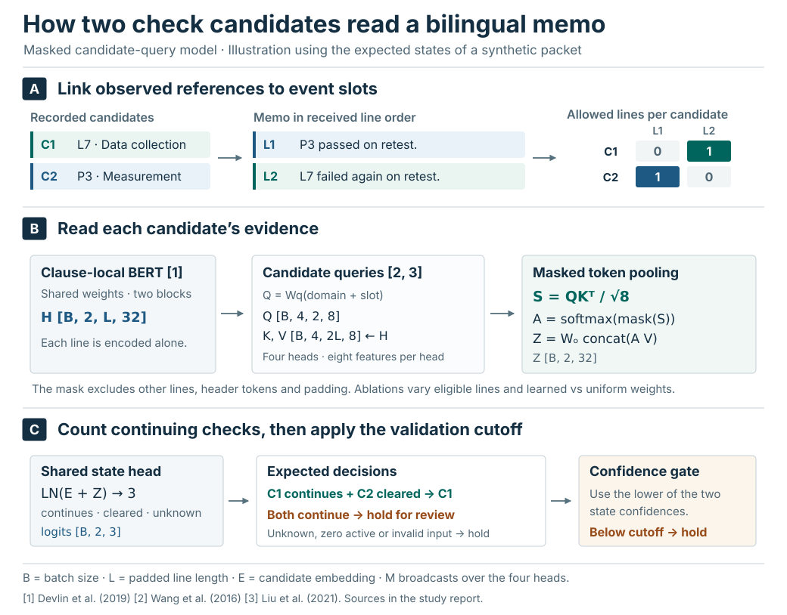

# Routing bilingual memos by candidate state

A memo reports the latest outcomes of two registered checks. If a data-collection error persists and a measurement fault clears, route to data collection. If both persist, the record supports two checks and the system holds it for review. This study asks how reliably a model can distinguish the two cases when only one memo line changes. The code runs offline and separately from the equipment replay app.

[Measured results](REPORT.md) · [Locked protocol](PROTOCOL.md) · [Full score table](run/metrics.csv) · [Paired intervals](run/contrasts.csv) · [Figure in Korean](../../docs/assets/candidate-states-ko.svg)



## Reproduce

From the repository root, create a Python 3.12 environment. The recorded run uses the following CPU build and project dependencies.

```sh
python -m pip install --index-url https://download.pytorch.org/whl/cpu torch==2.9.1
python -m pip install -r research/candidate-states/requirements.txt
cd research/candidate-states
python data.py --verify
TOKENIZERS_PARALLELISM=false python study.py benchmark --out my-replication
```

The benchmark generates the synthetic packets in memory. It fits and calibrates all methods before scoring the challenge. It writes the selected method and gates to `validation.json`, an inspectable score table to `metrics.csv`, paired contrasts to `contrasts.csv`, and detailed aggregates to `aggregates.json.gz`. The last file contains the confusion matrices, risk–coverage grid, exact pair counts, case slices, state accuracy and family contributions. `gzip -dc run/aggregates.json.gz` decompresses the recorded result. Timings depend on hardware and load.

For a single packet, pass two ordered `DOMAIN:TAG` records and the received lines. The default method is selected on validation. Use `--method bert_bound_query --seed 42` to run the architecture shown in the figure, or `--gate safety` to use the stricter validation criterion. The language flag controls the displayed action independently of the input language.

```sh
python predict.py --candidate data:L7 --candidate measurement:P3 \
  --line 'P3 passed on retest.' --line 'L7 failed again on retest.'

python predict.py --candidate data:L7 --candidate measurement:P3 --lang ko \
  --line 'P3 재검 결과 정상.' --line 'L7 재검에서도 불량.'
```

The process fits its selected model locally from scratch. For a batch, use `python predict.py --jsonl` and supply one JSON object per input line. Fitting happens once per process. Here is one packet in that format.

```json
{"candidates":[{"domain":"data","tag":"L7"},{"domain":"measurement","tag":"P3"}],"memo":"P3 passed on retest.\nL7 failed again on retest."}
```

The four domain IDs are `measurement`, `data`, `setup` and `equipment`. The prediction entry point holds missing, duplicate or ambiguous records. Each nonblank JSONL line receives one decision. A malformed packet is held and the following packet is processed. It also holds lines longer than the supported 120 subwords. This interface assumes two distinguishable checks and up to two newline-delimited observations.

## Evidence visible to every model

The input contains the two domain IDs and tag strings in their received order. A memo line identifies a tag or one of the interface’s ordinal expressions: `first listed check`, `second listed check`, `앞 점검 항목` or `뒤 점검 항목`. The binder searches the observed registry and these ordinal expressions. It replaces matched reference text with a common marker and records which slot it names. A complete packet has two distinct known domains, two distinct valid tags, two lines and a one-to-one binding. A previously unseen tag can be resolved directly when it appears in the current registry. That ability comes from matching the input record. No evaluation label enters the mask. [Binder and decoder](routing.py)

A missing line, missing domain, unlisted reference and duplicate reference are separate integrity failures. There are also semantically unanswerable **complete** packets. For example, if both final readings are missing, the same visible text is compatible with the first check continuing or the second check continuing. The gold decision is hold in either case. All methods observe the same normalized information. Scoped readers use the supplied correspondence explicitly.

## Tensor readout

The candidate model encodes each memo line in its own batch entry with a shared bidirectional encoder. Each line starts with CLS, both domain IDs and its observed slot binding, followed by memo subwords and SEP. Each of the two blocks has four heads, width 32, residual connections, layer normalization and a feed-forward layer. The tokenizer is fitted only on training text; all encoder weights start from random initialization. The flat BERT control sees both lines in a single sequence with the same header and binding features. [Encoder and readouts](encoder.py) · [Repository QKV block](../public-logbert/bert_mlm.py)

For batch size `B` and padded clause length `L`, the shared encoder gives `H[B,2,L,32]`. Projecting domain-plus-slot embeddings gives candidate queries `Q[B,4,2,8]`. Projecting the line states gives `K,V[B,4,2L,8]`. In the bound arm the Boolean mask is true only at actual memo tokens on the candidate's matched line. Header tokens, separators and padding never receive pooling weight. The four heads produce the following outputs.

```text
A = softmax(mask(Q Kᵀ / √8), token axis)
Z = output_projection(concatenate_heads(A V))
state_logits = shared_linear(layer_norm(domain_embedding + slot_embedding + Z))
```

`state_logits[B,2,3]` describes continues, cleared and unknown for each candidate. Exactly one continuing and one cleared state routes to the continuing check. All other combinations hold. An additional gate uses the smaller of the two state confidences. The printed confidence is a model score, not a verified probability of correct routing. The diagram is original vector artwork, generated locally with `python draw_figure.py`.

## What each comparison changes

| Comparison | What it measures |
| --- | --- |
| Raw vs guarded direct scores | The effect of requiring an intact record and restricting actions to the two observed candidates, using the same fitted probabilities. |
| Mention heads vs observed binding | The same character models predict each line's state. The diagnostic substitutes the visible binding for the learned target heads. |
| Global vs bound character states | One shared candidate classifier sees its own evidence and, in the global arm, a separate feature channel for the other line. Both receive the same slot and domain features. |
| Flat direct, local direct, local CLS states | The effect of clause-local contextualization and state supervision. The state loss and training labels differ from the action loss and labels. |
| All vs bound support; mean vs query | The same clause encoder, candidate embeddings, shared state head and routing policy isolate the eligible tokens and learned pooling weights. The uniform arm has fewer active projection parameters. |
| Exactly one vs winner-take-all | The same fitted state scores and input guard are reused. The alternative chooses the highest continuing score when both checks continue. Zero-cutoff comparisons isolate this policy change from gate recalibration. |
| Gold states + exact count | A construction check verifies that the decoder can express the target rule. This oracle requires labels unavailable at inference. |

## Data, provenance and scope

The author-created challenge contains 2,544 training rows in 12 wording families, 848 validation rows in four families, and 1,696 challenge rows in eight families. Each family crosses two domain pairs with two languages, seven core state combinations and seven alias/order views, plus four integrity failures per domain pair and language. Sibling views include duplicate normalized meanings by design. The independent unit for uncertainty is a wording family. The entire challenge contains only 16 distinct family-by-equipment-pair situations.

The wording and generator are original synthetic materials covered by the repository license. No third-party text corpus, customer records, external weights or private evaluation files are needed. The reusable benchmark, its pre-fit fingerprints and all reported results are public-ready research materials. Once released, this challenge is available for reproduction and cannot serve as a new blind test for subsequent tuning. [Wording families](wordings.txt) · [Generator](data.py) · [Fingerprints](manifest.json)

## Research sources and the design decision

BERT supplies a bidirectional contextual encoder. In aspect-level sentiment analysis, Wang and colleagues condition the interpretation of a sentence on the aspect being queried. Query2Label uses label queries to extract evidence from image features. Together these results motivate testing a separate query for each recorded check. Here the queries refer to the two candidates in the input and the record provides an observable correspondence mask. Uniform pooling and a structured linear classifier test whether the learned queries add value. [1. Devlin et al., 2019](https://aclanthology.org/N19-1423/) · [2. Wang et al., 2016](https://aclanthology.org/D16-1058/) · [3. Liu et al., 2021](https://arxiv.org/abs/2107.10834)

Concept bottleneck models motivate evaluating intermediate predictions as well as final actions. CheckList motivates interventions that preserve or change the expected output. Work on selective prediction motivates reporting coverage alongside errors among accepted decisions. This study combines those ideas in a constrained bilingual routing experiment. The exact-count policy follows the task definition; the learned part is the reading of each candidate's current state. [Koh et al., 2020](https://proceedings.mlr.press/v119/koh20a.html) · [Ribeiro et al., 2020](https://aclanthology.org/2020.acl-main.442/) · [Geifman and El-Yaniv, 2019](https://proceedings.mlr.press/v97/geifman19a.html)

