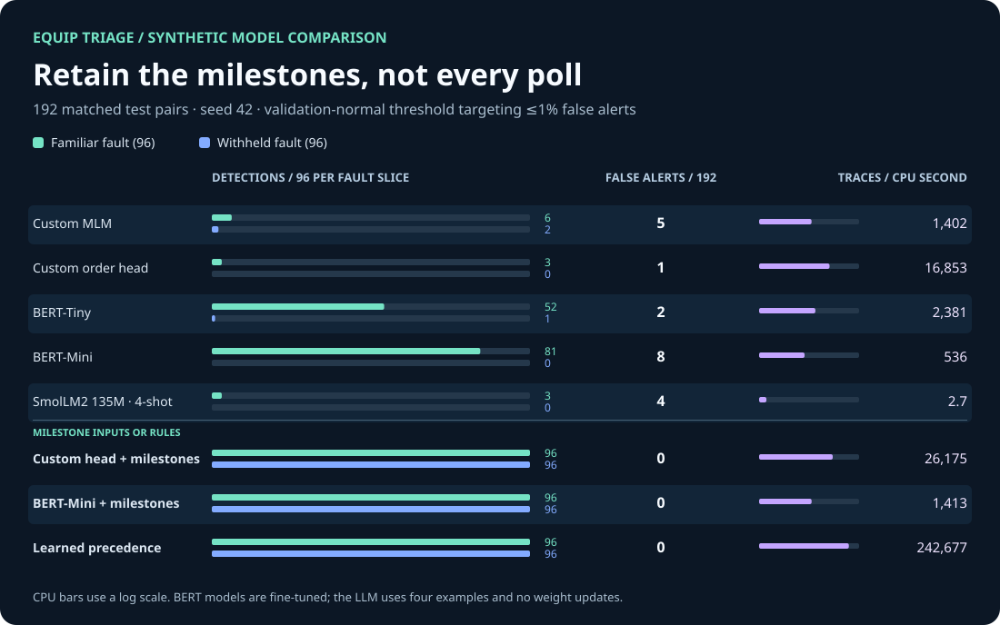

# External encoder and language-model comparison

Which detectors recognize an invalid order when the equipment supports two valid workflows? This benchmark reruns the existing masked language model (MLM) and order classifier on the same synthetic sessions as two Google BERT checkpoints. A separate track evaluates a frozen instruction model with four examples. Every model executes locally on CPU.

## Results



Regenerate the figure from the checked-in aggregate CSV with `python plot.py`.

Each raw-input method scored the same original test traces. The projected-input controls used the same fitted event filter. Values below use seed 42. The full CSV includes both normal workflow slices and the extra order-model initializations. [Chart data](metrics.csv) · [Run aggregates and timings](results.json)

| Method | Familiar swap detected / 96 | Withheld swap detected / 96 | Normal alerts / 192 | AP | Traces / CPU s |
|---|---:|---:|---:|---:|---:|
| counts | 0 | 0 | 0 | 0.500 | 953,004.9 |
| trigram | 44 | 96 | 3 | 0.939 | 32,321.5 |
| precedence | 96 | 96 | 0 | 1.000 | 242,676.9 |
| mlm | 6 | 2 | 5 | 0.648 | 1,401.9 |
| order | 3 | 0 | 1 | 0.629 | 16,853.4 |
| tiny_random | 3 | 1 | 2 | 0.562 | 2,469.8 |
| tiny_pretrained | 52 | 1 | 2 | 0.788 | 2,381.5 |
| mini_random | 72 | 2 | 8 | 0.791 | 545.6 |
| mini_pretrained | 81 | 0 | 8 | 0.767 | 536.0 |
| milestone_order | 96 | 96 | 0 | 1.000 | 26,175.2 |
| tiny_milestones | 96 | 48 | 0 | 0.917 | 4,755.7 |
| mini_milestones | 96 | 96 | 0 | 1.000 | 1,413.4 |
| smol | 3 | 0 | 4 | 0.498 | 2.7 |

The raw-input order head found 1–4 of 192 anomalies across three training seeds. The milestone projection found 192 with zero false alerts for all three. Two normal symbolic orders recur after projection, so those 192 raw examples do not represent 192 different equipment procedures. The normal-only precedence learner also achieved 192/192 with zero false alerts at a lower CPU cost. BERT-Mini matched that result given the same projected inputs. This supports the representation change for these generated telemetry variations. It gives no basis for a general architecture ranking. The earlier order experiment used a different grammar and a larger training set, so a difference between studies cannot be attributed solely to permitted reordering.

SmolLM2 found three familiar swaps and no withheld swaps at its fixed threshold. AP was 0.498 with equal class sizes. This is one frozen 135M-parameter instruction model, one four-example prompt and one choice of label tokens. Only the two order-head variants were repeated across initialization seeds. No language-model family conclusion or deployment latency estimate follows from this small pilot.

## Design

The generator produces 384 training pairs, 128 validation pairs and 192 held-out pairs with data seed 241125. Every original trace is unique across all three partitions. Each pair has exactly the same event counts and length. CLAMP and ZERO may occur in either order before SCAN. RELEASE must follow SCAN. Each milestone is preceded by one to four POLL, WAIT, SAMPLE or ACK events. Both permissible workflows occur equally often in every partition.

Training swaps the second preparation milestone with SCAN. Of the 192 final pairs, 96 use this same corruption and 96 swap SCAN with RELEASE, a corruption excluded from training and calibration. Each corruption slice has 48 normal examples of each allowed workflow. All supervised models see exactly the same pair IDs and labels. Normal-only methods fit on the 384 original sessions. Each method sets its own alert threshold to the nearest-rank 99th percentile of 128 validation normal scores. An alert requires a score strictly above that threshold. Ties can make the achieved false-positive rate zero. A test false alarm changes the test rate by 1/192.

**Existing methods.** The bidirectional MLM and order head reuse the project implementations. The MLM scores mean leave-one-out token loss. The order head jointly optimizes MLM on normal traces and classification on matched pairs. Count profile, trigram and train-derived precedence rules provide inexpensive controls.

**Targeted change.** Fit a filter on the normal training sessions. Keep event types that occur exactly once in every one of those sessions. Apply this fixed projection before training and scoring the order head. In this generator the filter retains START, the four milestones and END. A telemetry-heavy trace and a telemetry-light trace can therefore yield the same model input. The input format deliberately collapses the 192 unique normal test sessions into just **two normal milestone sequences already seen during training**. The withheld corruptions yield two new milestone sequences. The result tests invariance to generated telemetry and transfer to one new swap. It offers little evidence about new equipment procedures. Missing, duplicated or informative telemetry would require a different design.

**BERT comparison.** Google BERT-Tiny and BERT-Mini consume the event names as space-separated English words via the publisher's WordPiece tokenizer. Both fine-tune all parameters with a binary classification head on the 384 labeled pairs. Each architecture is also fitted from random weights using the same tokenizer, head initialization, example order and optimization recipe. As an input control, each pretrained BERT also trains and evaluates on the same projected milestone sequences as the targeted upgrade. BERT uses ten epochs, 64 pairs per optimizer step, AdamW at 0.0001 and cross entropy. The project models use ten epochs, the same batch of pair IDs and AdamW at 0.001. The order models additionally optimize MLM. Different input encodings and loss functions are part of the comparison. These fixed training budgets do not establish the best performance each architecture can attain.

**Frozen language model.** SmolLM2-135M-Instruct receives two normal and two corrupt examples from the first two training pairs in ABBA order, followed by a single query. The prompt gives the class meanings. It includes no test examples or explicit equipment rules. The published chat template supplies the assistant prefix. The score subtracts the next-token logit for A (normal) from that for B (faulty). Both label strings tokenize to single tokens. There is no sampling, text decoding, fine-tuning or inference API. The LLM sees only four labeled demonstrations and gets a validation-normal operating threshold, so its result belongs to a few-shot track. Larger language models and other prompt or label choices remain unmeasured.

Both the cutoff and the reported AP use session scores. AP integrates precision over recall steps while grouping tied scores. The balanced-pair test has anomaly prevalence 50%, so random ranking gives expected AP near 0.5. This prevalence and the resulting precision do not estimate field performance. See the per-slice confusion counts, pair wins and exact thresholds in the aggregate results.

## Runtime and reproducibility

Use Python 3.12, PyTorch 2.9.1+cpu and Transformers 4.57.3. All runs use FP32 and one PyTorch computation thread. Run from this folder within a checkout that includes the sibling order-aware and public-logbert source modules. For example:

```sh
python -m pip install torch==2.9.1 --index-url https://download.pytorch.org/whl/cpu
python -m pip install transformers==4.57.3 numpy==2.3.5
export TOKENIZERS_PARALLELISM=false
python -B compare.py --method tiny_pretrained --fetch --cache /tmp/equip-external --out /tmp/tiny.json
python -B compare.py --method order --out /tmp/order.json
python -B compare.py --method milestone_order --seed 42 --out /tmp/upgrade.json
python -B compare.py --method smol --fetch --cache /tmp/equip-external --out /tmp/smol.json
```

For an offline rerun omit `--fetch` after populating the cache. `--help` lists the other methods. Each run emits only aggregates. The source manifest records exact publisher revisions, model weight file names and SHA256 hashes checked against the publishers' LFS metadata. All three cards identify Apache 2.0. This folder contains original experiment code and measurements. All pretrained and fitted weights stay outside the repository. [Checkpoint provenance](sources.json)

CPU scoring time covers encoding, model calls and score extraction for 384 test traces after calibration. Neural batch sizes are 32 for the project models, 16 for BERT and eight for the LLM. The MLM requires repeated masked passes. The LLM recomputes its four-example prefix for every trace. These rates describe batched CPU throughput with these implementations. Fit/load time includes optimizer setup and checkpoint loading where applicable. Numerical metrics use training seed 42 by default. Additional seeds 41 and 43 repeat the original and projected order heads on the same fixed data. The HDFS study used different inputs and labels. No HDFS or field metric was measured in this comparison.
